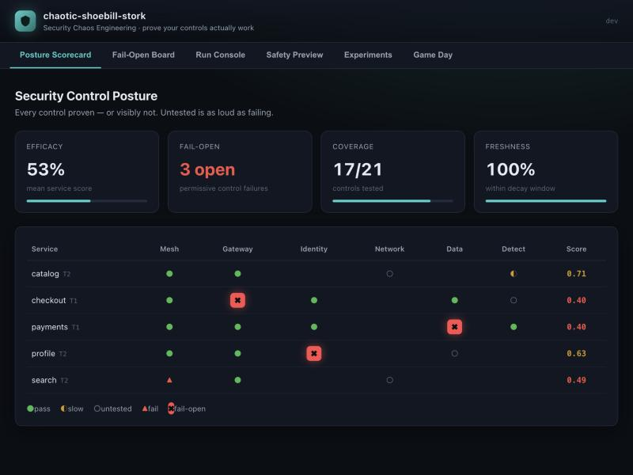
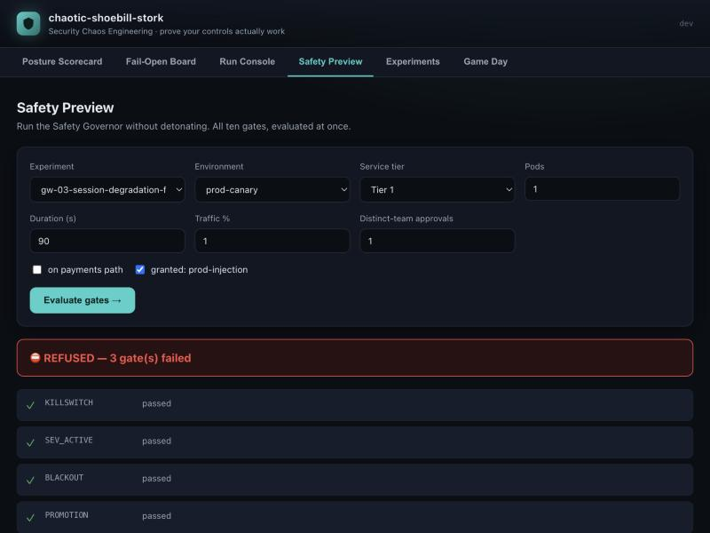
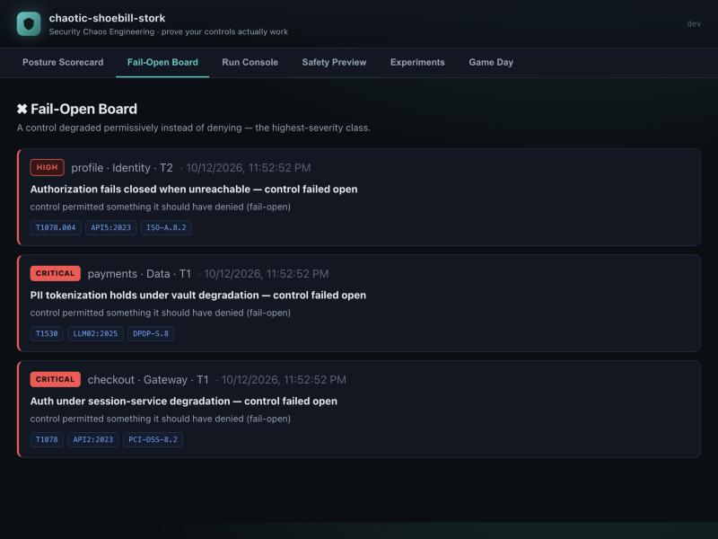

<div align="center">

# 🪶 chaotic-shoebill-stork

### Security Chaos Engineering — prove your security controls *actually* work.

*Stop hoping your security controls hold. Detonate a safe, bounded, reversible adversarial
condition, assert whether the control **prevented, detected, alerted, and paged** within its SLO,
sign the evidence, and roll it into a per-service **control-efficacy scorecard**.*

[](LICENSE)
[](go.mod)


<br/>



</div>

---

## The problem

You deployed world-class security **controls** — service-mesh mTLS and authorization policy, API
gateway auth and rate limits, secrets and certificate lifecycle, PII tokenization, image-admission
control, detection rules and paging. What you almost certainly **don't** have is *continuous,
automated proof that any of them still work.*

Control efficacy is discovered in one of two expensive ways:

- **At 3 a.m. during an incident**, when a control that worked last quarter silently decayed — a
  mesh policy reverted to permissive during a migration, an allowlist widened for debugging and
  never narrowed, a detection rule pointing at a metric label a dependency renamed, an
  authorization service whose timeout fallback happens to be *permissive*.
- **Annually during an audit**, which samples *configuration* (intent), never *runtime behavior*.

The worst class — **fail-open under stress** — is the direct, under-tested cost of graceful
degradation: every fallback path was written and tested for *availability*, almost none for
*authorization*. Highest severity, lowest observability.

**`shoebill` makes control efficacy a continuously-refreshed, signed, honest number.**

## What is (Security) Chaos Engineering?

It's a lesser-known discipline, so here's the short version.

**Chaos Engineering** was pioneered at Netflix (the famous "Chaos Monkey" that randomly killed
servers in production). The counter-intuitive idea: *you don't build confidence that a system is
resilient by hoping — you build it by deliberately injecting controlled failure and watching whether
the system withstands it.* A fire drill for your infrastructure. You form a hypothesis ("if this
node dies, traffic reroutes and users never notice"), inject the failure in a bounded way, and
verify the hypothesis held. If it didn't, you found the weakness on your terms, not during a 3 a.m.
outage. It is now a mainstream reliability practice (CNCF's LitmusChaos and Chaos Mesh, AWS Fault
Injection Service, Gremlin).

**Security Chaos Engineering (SCE)** applies that exact method to your *security controls* instead of
your *availability*. The term was coined by Aaron Rinehart and popularized in the O'Reilly book
*Security Chaos Engineering* (Kelly Shortridge & Aaron Rinehart, 2023). The insight: a firewall rule,
an authorization policy, a detection alert, or a PII-tokenization step is also just a hypothesis —
"this control will block / detect / alert on this bad thing" — and the only way to *know* it still
holds is to safely reproduce the bad thing and watch. Most teams never do; they assume the control
works because it was configured once. SCE replaces that assumption with evidence.

**Why it's barely tooled.** Reliability chaos has mature platforms; *security* chaos has almost
none in the open. The one early open-source attempt (AWS's ChaoSlingr) was archived in 2019, and the
commercial tools that do it (SafeBreach, AttackIQ, Picus, Cymulate) are closed and expensive.
`shoebill` is a clean-room, Apache-2.0 platform built for this specific job — with the safety rails
and signed evidence that make it trustworthy enough to actually run.

## Why this is new

Reliability chaos engineering is mature (LitmusChaos, Chaos Mesh, Gremlin). *Security* chaos
engineering — proving **security controls** still behave under a safe, governed, adversarial
condition — is essentially un-served in open source. No maintained OSS platform combines all five of:

1. security controls modeled as **hypotheses** + a per-service **efficacy scorecard**,
2. a first-class **Safety Governor** (the only door to injection),
3. **adversarial** detonation (not just reliability faults),
4. **SLO-bounded, multi-outcome** assertion (PREVENTED / DETECTED / ALERTED / PAGED), and
5. **signed, portable evidence**.

The only OSS tool ever aimed here, ChaoSlingr, was archived in 2019. The tools that solve it today
— SafeBreach, AttackIQ, Picus, Cymulate — are all **closed, commercial**, with no signed-attestation
story. That is the open-source whitespace this fills. `shoebill` builds the governed loop and
integrates the detonators and signal sources that already exist. See [`finding.md`](finding.md).

## 60-second quickstart

```bash
go install github.com/dibakshya01/chaotic-shoebill-stork/cmd/shoebill@latest

shoebill demo            # run the whole loop in-process; writes signed evidence + a scorecard
shoebill evidence verify # verify the signatures, hash chain, and signed head
shoebill serve --demo    # open http://127.0.0.1:8099 for the dashboard
```

No Kubernetes, no network, no external dependencies — the entire
hypothesize → gate → detonate → observe → revert → adjudicate → sign → score loop runs on your
laptop, deterministically.

`shoebill demo` produces, among others, three **real** fail-open findings and caps the two Tier-1
services at 0.40:

```
  Security Control Posture
  ────────────────────────────────────────────────────────
  Efficacy 53%   Fail-open 3 open   Coverage 17/21   Freshness 100%

                     Mesh  Gwy   Idnt  Netw  Data  Detc   Score
  checkout       T1    ●     ✖     ●           ●     ○    0.40
  payments       T1    ●     ●     ●           ✖     ●    0.40
  profile        T2    ●     ●     ✖           ○          0.63
  search         T2    ▲     ●           ○                0.49
  catalog        T2    ●     ●           ○           ◐    0.71

  ● pass  ◐ slow  ○ untested  ▲ fail  ✖ fail-open
```

## How it works — the core loop

Every part of the platform serves one seven-step loop. If a decision doesn't make a step **faster,
safer, or more trustworthy**, it's out of scope.

```
1. HYPOTHESIZE  Control C prevents/detects condition X within SLO S. Steady state = P.
2. GATE         Safety Governor: env? blackout? budget? approvals? steady state P true NOW?
                concurrency? fault domains distinct?  (any no → REFUSE, with a reason + remedy)
3. ARM          Mint a signed, scoped, time-boxed capability. Register expected-noise suppression.
                Announce. Arm the dead-man's switch. Generate the run UUID.
4. DETONATE     Inject condition X, with the run UUID woven into every artifact.
5. OBSERVE      Collect the ladder, correlating strictly on the UUID:
                PREVENTED? DETECTED? ALERTED? PAGED? — and each stage's latency.
6. REVERT       Undo. Verify the undo independently. Revoke the capability. Expire suppression.
7. ADJUDICATE   PASS | FAIL_UNDETECTED | FAIL_OPEN | FAIL_SLOW | ABORTED | INCONCLUSIVE
                → sign an evidence receipt → update the Control Efficacy Score → open/close a finding.
```

## What makes it trustworthy

- **One door to injection.** The [Safety Governor](docs/safety-model.md) is the *only* path.
  Nothing detonates without an `Allowed` decision, and each detonator verifies a **governor-minted,
  Ed25519-signed, scoped, time-boxed capability** before it acts — a structural gate, not a
  convention. A **dead-man's switch** forces a revert if a revert fails; its autonomous
  silence-detector (revert the fault if the control plane goes quiet) is unit-tested and is the
  operator agent's job on a live cluster (see [roadmap](ROADMAP.md)).
- **It never lies.** `FAIL_OPEN` is its own verdict and dominates everything. `INCONCLUSIVE` *never*
  becomes `PASS` — if we couldn't observe, we learned nothing. An expected-but-**untested** control
  scores **0.0**, not "unknown".
- **Causality, not coincidence.** A run UUID is woven into every artifact and *required* by every
  assertion, so a run that merely coincides with unrelated alert noise can never score a false PASS.
- **Evidence an auditor can trust without trusting us.** Receipts are Ed25519-signed and
  self-describing; the ledger is a hash chain with a separately-signed head, making it tamper-,
  reorder-, and tail-truncation-evident. `shoebill evidence verify` needs only the public key.

<div align="center">


</div>

## The experiment catalog

Experiments are **data, not code** — a declarative hypothesis and its assertions, never a payload
with side effects. Nine families, each mapped to authoritative standard IDs (MITRE ATT&CK v19,
OWASP API/Top-10/LLM/Agentic/AISVS, PCI-DSS v4.0.1, ISO 27001:2022, NIST 800-53, SOC 2, DPDP):

| Family | What it verifies |
|--------|------------------|
| **Service Mesh** | mTLS, authorization policy, workload identity, egress control |
| **Gateway & Edge** | auth under session-service degradation, rate limits, JWT validation, WAF |
| **Identity & Secrets** | authz fail-closed, revocation TTL, cert/key lifecycle, leaked-credential detection |
| **Network & Perimeter** | network isolation, DNS integrity, firewall fail-closed, metadata-endpoint access |
| **Data Protection** | PII tokenization under vault degradation, canary-token boundaries, log redaction |
| **Supply Chain** | unsigned/privileged image admission, pipeline tamper, secret-in-repo gate |
| **DR & Resilience** | security posture survives failover, degradation modes preserve authz |
| **Detection & Response** | detection-rule regression, alert-to-page path, runbook executability |
| **AI / Agentic** | prompt-injection resistance, agent authz, MCP trust boundary, memory poisoning |

```bash
shoebill catalog validate ./catalog   # structure + standards + safety invariants
shoebill catalog list ./catalog
```

## What it is **not** (the [Charter](CHARTER.md))

- **Not** a red-team tool — no exploits, no 0-days, no lateral movement, no persistence.
- **Not** a data-exfiltration tool — data experiments use **canary tokens only**, never real PII.
- **Not** a vulnerability scanner — it tests whether *deployed controls behave*, not whether code
  has bugs.
- **Not** an observability or SIEM stack — it *queries* Prometheus/Alertmanager/etc., it doesn't
  replace them.
- Production injection is **off by default** and requires a signed, time-boxed capability plus
  two-person approval from distinct teams.

Read the honest [what it can & cannot do](docs/can-and-cannot.md).

## Project layout

```
cmd/shoebill/     the CLI                      internal/verify/   verification engine + sources
internal/model/   domain types + capability    internal/score/    control-efficacy score
internal/safety/  the Safety Governor          internal/evidence/ Ed25519-signed ledger
internal/engine/  the 7-step core loop         internal/api+ui/   REST API + embedded dashboard
internal/detonator/ safe detonators            catalog/           the experiment catalog (data)
operator/         Kubernetes CRDs + controller (separate module)
```

## Run it anywhere

`shoebill` is a single static Go binary (~9 MB) with the dashboard embedded — no runtime
dependencies — so it runs on a laptop, a VM, a container, or a Kubernetes pod.

```bash
# container (distroless, ~10 MB, non-root)
docker build -t shoebill:dev . && docker run --rm -p 8099:8099 shoebill:dev

# kubernetes (GKE / EKS / AKS / kind)
kubectl apply -k deploy/kubernetes/ && kubectl -n shoebill port-forward svc/shoebill 8099:80
```

The control plane runs on any cloud today. Real *in-cluster* detonation (container-kill, Istio,
NetworkPolicy) is the Kubernetes **operator** — CRDs are ready to apply; the controller is the next
milestone. Deep cloud *attack* coverage (metadata/IAM/VPC detonators, cloud monitoring sources) is on
the roadmap, via Stratus Red Team behind the detonator interface. See [`deploy/`](deploy/README.md)
and [`ROADMAP.md`](ROADMAP.md).

## Documentation

- [Architecture](docs/architecture.md) · [Safety model](docs/safety-model.md) ·
  [Standards mapping](docs/standards-mapping.md)
- [Writing experiments](docs/writing-experiments.md) · [What it can & cannot do](docs/can-and-cannot.md)
- [Deploying](deploy/README.md) · [Roadmap](ROADMAP.md)
- [Research & the gap](finding.md) · [Build plan / spec](build-plan.md) · [Charter](CHARTER.md)

## Contributing

Issues and PRs welcome — see [CONTRIBUTING.md](CONTRIBUTING.md), the
[Code of Conduct](CODE_OF_CONDUCT.md), and the [Security policy](SECURITY.md). Changes to the
Safety Governor and the evidence ledger get extra review (see [CODEOWNERS](CODEOWNERS)).

## License

[Apache-2.0](LICENSE). A clean-room, vendor-neutral open-source work.
